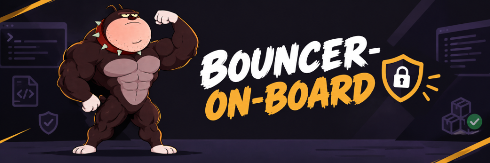

<p align="center">
  
</p>

# BOB (bouncer-on-board)

> Zero-trust firewall and pre-deploy security gatekeeper for coding agents.

[](LICENSE)
[](pyproject.toml)
[](skills/bob/SKILL.md)

Coding agents move fast, but they can install hallucinated packages, run malicious build scripts (`preinstall`, `setup.py`), or commit leaked secrets. BOB catches these before they run.

---

## What BOB does

- Blocks dangerous `pip` and `npm` installs before lifecycle scripts execute.
- Rejects unregistered packages, typosquats, and slopsquatting vectors before download.
- Blocks unauthorized agent reads targeting `.env`, `.ssh/`, and cloud credentials.
- Flags prompt injection inside markdown files, issues, and prompts before agents ingest them.
- Scans code for hardcoded secrets, SQL injection, dynamic eval, and unverified TLS.
- Explains findings with plain-English fixes using your IDE agent, local Gemma, or cloud AI. The AI cannot downgrade Critical or High findings.

---

## Architecture

```
                 ┌─────────────────────────────────────────────────────────────┐
                 │                   Path 1: `bob intercept`                   │
  Agent Action ─►│  Pre-Execution Gate: Blocks hallucinated packages, typos,  │─► Executed
                 │  install scripts, and credential reads BEFORE execution.    │   (or Blocked)
                 └─────────────────────────────────────────────────────────────┘
                                                │
                                                ▼
                 ┌─────────────────────────────────────────────────────────────┐
                 │                     Path 2: `bob scan`                      │
  Pre-Deploy   ─►│  Pre-Deploy Gate: Parallel deterministic tripwires + local  │─► Ship / PR
                 │  Gemma 4 triage, plain-English explanations & patch diffs.  │
                 └─────────────────────────────────────────────────────────────┘
```

1. **Pre-execution gate (`bob intercept`)**: Intercepts commands and file reads before anything runs. Scanning after an install finishes is too late: npm lifecycle scripts and Python sdist packages run arbitrary code during download. Target latency is under 400ms using deterministic rules.
2. **Pre-deploy gate (`bob scan`)**: Runs deterministic scanners in parallel (secrets, AST checks, CVEs), then uses your active IDE model or local Gemma to explain risks and generate fix diffs.

For full sequence diagrams and defense layers, see [docs/architecture.md](docs/architecture.md).

---

## Quickstart

### 1. Install via npx or npm
Install BOB globally or deploy it directly into your current workspace:

```bash
# Interactive setup and universal IDE skill deployment:
npx bouncer-on-board install

# Or install globally via npm:
npm install -g bouncer-on-board
bob doctor
```

### 2. Install via Python
```bash
pip install git+https://github.com/shouryasingh2311/bouncer-on-board.git
bob doctor
```

### 3. IDE slash commands (`/bob`)
Once installed, BOB operates natively inside your preferred IDE:

| IDE / Environment | Integration | Primary Slash Commands |
|:---|:---|:---|
| **Claude Code** | Global Skill (`~/.claude/skills/bob/SKILL.md`) + PATH shims | `/bob scan`, `/bob check <pypi\|npm> <pkg>`, `/bob doctor` |
| **Google Antigravity** | Workspace Skill (`~/.gemini/config/skills/bob/SKILL.md`) + PreToolUse Hook | `/bob scan`, `/bob check <pypi\|npm> <pkg>`, `/bob protect` |
| **Cursor / VS Code** | Cursor Rules (`.cursor/rules/bob.mdc`) + Terminal shims | `/bob scan`, `/bob guard <file>`, `/bob doctor` |

> When BOB runs as an IDE skill, external AI endpoints (Ollama, Gemini, OpenAI) are optional (`ai_provider: "ide_native"`). The active model in your IDE (Claude, Gemini, Cursor) directly reviews findings and proposes fixes in chat.

---

## Examples

### Catching typosquats and hallucinated packages
Simulate an agent attempting to download a hallucinated or typosquatted package:

```bash
bob check-install pypi reqeusts
```

Output:
```
BOB BLOCKED [BOB-0001] rule=PKG-NOT-FOUND package=reqeusts
Reason: Package 'reqeusts' does not exist on PYPI (likely AI hallucinated / slopsquatting vector).
Do: remove it, ask the user, or pick a verified package. Do not retry this install.
```

### Catching prompt injection in issues and docs
Check untrusted instructions or documentation before an agent ingests them:

```bash
bob guard-text prompt.md
```

Output:
```
BOB BLOCKED [BOB-0001] rule=INJ-001 file=prompt.md
Reason: Instruction override phrase
BOB BLOCKED [BOB-0002] rule=INJ-020 file=prompt.md
Reason: Instruction to send secrets or env data to a URL
```

### Scanning code before commit or deploy
Scan any source tree for hardcoded secrets, SQL injection, dynamic eval, and unverified TLS:

```bash
bob scan src --no-ai
```

Output:
```
BOB Pre-Deploy Scan Summary (src)
+------------------+
| Severity | Count |
|----------+-------|
| CRITICAL | 0     |
| HIGH     | 0     |
| MEDIUM   | 0     |
| LOW      | 0     |
| INFO     | 0     |
+------------------+
0 known deterministic tripwires hit.
```

### Verifying a fix without rescanning everything
Re-test the specific rule that flagged an issue:

```bash
bob verify 8a08c677ec
```

### Checking system status
Verify runtime dependencies, active shims, and configured AI provider:

```bash
bob doctor
```

---

## Commands

| Command | Purpose | Key Flags | Exit Codes |
|:---|:---|:---|:---|
| [`bob setup`](#1-bob-setup) | Interactive onboarding assistant for AI models and IDE protection | *None (interactive wizard)* | `0` success |
| [`bob protect`](#2-bob-protect) | Configure automated interception hooks for IDE workspaces | `[path]`, `--ide` | `0` success |
| [`bob check-install`](#3-bob-check-install) | Inspect a package before installation (typos, age, scripts, CVEs) | `<ecosystem>`, `<pkg>`, `--json` | `0` allow, `2` block |
| [`bob intercept`](#4-bob-intercept) | Pre-execution gatekeeper for agent commands and sensitive paths | `--cmd`, `--adapter`, `--path` | `0` allow, `2` block |
| [`bob scan`](#5-bob-scan) | Pre-deploy security gate and SARIF scan with AI triage | `[path]`, `--no-ai`, `--out-dir` | `0` pass, `1` blocked |
| [`bob verify`](#6-bob-verify) | Re-run originating tripwire to verify a fix | `<fingerprint-prefix>` | `0` fixed, `1` still failing |
| [`bob guard-text`](#7-bob-guard-text) | Detect prompt injection in docs and issues | `<path>`, `--ai` | `0` clean, `2` threat |
| [`bob audit`](#8-bob-audit) | Scan project lockfiles against the OSV database | `[--path]` | `0` clean, `1` vulnerable |
| [`bob shim`](#9-bob-shim) | Manage terminal PATH wrapper scripts for package managers | `install`, `uninstall` | `0` success |
| [`bob allow`](#10-bob-allow) | Human-only allowlist entry in `.bob/allowlist.yaml` | `<pkg>`, `--ecosystem` | `0` success |
| [`bob doctor`](#11-bob-doctor) | Diagnostics for scanners, shims, and model connection | *None* | `0` ready |

---

### Command details

#### 1. `bob setup`
Interactive setup assistant. Guides you through configuring your AI provider and setting up IDE workspace protection.

```bash
bob setup
```

- Step 1 (AI Provider): Choose IDE-Native AI (recommended for IDE skills), local Ollama (Gemma), cloud APIs (Gemini, OpenAI, Groq), or pure deterministic mode.
- Step 2 (IDE Protection): Choose your editor (VS Code, Google Antigravity, Cursor, Claude Code, or all) to configure hooks and shims.

---

#### 2. `bob protect`
Configures pre-execution interception hooks, rules, and PATH shims in a workspace.

```bash
# Protect current workspace
bob protect

# Protect a specific project folder for VS Code
bob protect /path/to/project --ide vscode

# Protect for Google Antigravity
bob protect . --ide antigravity
```

What it configures:
- `.agents/hooks.json` (Antigravity pre-tool-use hook)
- `.cursor/rules/bob.mdc` (Cursor rule instructions)
- `.vscode/settings.json` (Terminal PATH interception for VS Code and Cursor)
- `~/.bob/shims` (Global wrapper shims for terminal commands)

---

#### 3. `bob check-install`
Inspects a package before installing it. Evaluates name similarity against top packages, release age, download metrics, install-time scripts (`preinstall`, `setup.py`), and OSV advisories.

```bash
# Inspect a safe PyPI package
bob check-install pypi requests

# Check a specific version of an npm package
bob check-install npm express==4.18.2

# Check a typosquatted package (blocks with exit code 2)
bob check-install pypi reqeusts

# Output structured JSON result for CI/CD scripting
bob check-install pypi demo-malicious-pkg --json
```

Exit codes: `0` = Allowed; `2` = Blocked.

---

#### 4. `bob intercept`
Synchronous pre-execution hook entrypoint. Called automatically by IDE hooks and PATH shims before any command touches the system.

```bash
# Intercept an install command
bob intercept --adapter generic --cmd "pip install reqeusts"

# Intercept an attempt to read sensitive credential files
bob intercept --adapter generic --cmd "cat ~/.ssh/id_rsa"

# Intercept a direct file read probe
bob intercept --adapter generic --path ".env"
```

Protection scope:
- Blocks typosquatted or non-existent packages (slopsquatting).
- Blocks packages containing malicious install-time hooks.
- Blocks unauthorized access to sensitive credential files (`.env`, `.ssh/`, `.aws/`, `.git/config`).
- Blocks tampering attempts against `.bob/`.

Exit codes: `0` = Allow; `2` = Block.

---

#### 5. `bob scan`
Pre-deploy security gate. Runs parallel scanners (`gitleaks`, `semgrep`, OSV, and built-in AST checks), then invokes your configured AI provider to triage false positives, explain root causes, and produce fix diffs.

```bash
# Run full scan with AI triage and explanations
bob scan .

# Run deterministic scan only (faster, zero AI calls)
bob scan ./src --no-ai

# Specify custom output directory for reports
bob scan . --out-dir ./audit-reports
```

Outputs:
- Terminal summary table.
- `.bob/report.md` (Detailed report with code snippets, CWEs, and suggested diffs).
- `.bob/report.json` and standard SARIF report.

Exit codes: `0` = Passed; `1` = Gate failed (Critical or High findings detected).

---

#### 6. `bob verify`
Re-runs the exact check that flagged a vulnerability to confirm whether your code patch resolved it.

```bash
# Verify a specific finding using its fingerprint prefix
bob verify sec-001
```

Exit codes: `0` = Fixed; `1` = Finding still active.

---

#### 7. `bob guard-text`
Scans markdown files, issue templates, PR descriptions, or documentation for prompt injection payloads and data exfiltration markers before an agent reads them.

```bash
# Scan a documentation file for prompt injection
bob guard-text docs/untrusted_issue.md
```

Exit codes: `0` = Clean; `2` = Threat detected.

---

#### 8. `bob audit`
Scans dependency lockfiles against the OSV vulnerability database. Supports `requirements.txt`, `package-lock.json`, `pnpm-lock.yaml`, `Pipfile.lock`, and `poetry.lock`.

```bash
bob audit
bob audit --path ./backend
```

Exit codes: `0` = Clean; `1` = Vulnerabilities found.

---

#### 9. `bob shim`
Manages PATH wrapper shims for `pip`, `npm`, `yarn`, `pnpm`, and `uv`. Shims route terminal package installs through BOB before packages can run lifecycle scripts.

```bash
bob shim install
bob shim uninstall
```

---

#### 10. `bob allow`
Human-only override. Allows a developer to permit a flagged package by recording their name, reason, and timestamp in `.bob/allowlist.yaml`. AI agents are blocked from running this command.

```bash
bob allow my-private-company-pkg
bob allow @internal/custom-lib --ecosystem npm
```

---

#### 11. `bob doctor`
Health check for system environment, installed scanners (`gitleaks`, `semgrep`), Node.js bridge, active shims, and configured AI provider.

```bash
bob doctor
```

---

## How AI triage works

Deterministic scanners detect findings; the AI triages, explains, and suggests fixes. Because input can be adversarial, BOB enforces strict code-level guardrails:

| What the AI does | What the AI cannot do |
|:---|:---|
| Explains flagged security issues in plain English | Detect vulnerabilities from scratch |
| Generates fix diffs for developer review | Override or downgrade Critical or High findings |
| Annotates test decoys with review notes | Approve an untrusted or blocked package |
| Provides second opinions on prompt text | Apply code changes automatically without review |
| Runs locally on your machine or inside your IDE | Run inside the live interception path |

> Clean scan message: `0 known deterministic tripwires hit. This does not guarantee the absence of business-logic vulnerabilities.` BOB reports deterministic results plainly without claiming to be unbreakable.

---

## Benchmarks

Benchmark results comparing deterministic checks alone versus deterministic checks with local Gemma triage:

| Metric | Deterministic only (`--no-ai`) | With local Gemma triage | Result |
|:---|:---:|:---:|:---|
| True Positives Detected | 8 / 8 (100%) | 8 / 8 (100%) | All critical threats caught |
| Planted Test Decoys Flagged | 3 / 3 (false alarms) | 0 / 3 (triaged to review) | Eliminates alert fatigue from test files |
| Critical / High Findings Preserved | 100% | 100% | Invariant: AI never overrides high severity |
| Fix Verification (`bob verify`) | N/A | 100% verified | Confirms proposed patch clears the tripwire |
| Scan Latency | ~0.8s | ~3.4s (local E2B) | Runs on CPU without specialized hardware |

---

## Limitations

- Detects known patterns only; does not find business logic flaws or novel zero-day malware.
- A newly published package that looks clean to heuristics can still be malicious.
- `python -m pip` and other indirect invocations can bypass PATH shims; IDE hooks catch these where supported.
- Registry or OSV network outages degrade online lookups (see `offline_policy`).

---

## Documentation

- [Architecture](docs/architecture.md): Sequence diagrams and defense layers
- [Verified run](docs/quickstart-verified.md): Execution traces and reproducible proof
- [Universal skill](skills/bob/SKILL.md): Slash commands for Claude Code, Cursor, and Antigravity
- [Third-party notices](THIRD_PARTY_NOTICES.md): Tool licenses and model terms
- [Contributing guide](CONTRIBUTING.md): Setup, testing, and adding rules
- [Security policy](SECURITY.md): Vulnerability reporting instructions
- [License](LICENSE): MIT License
