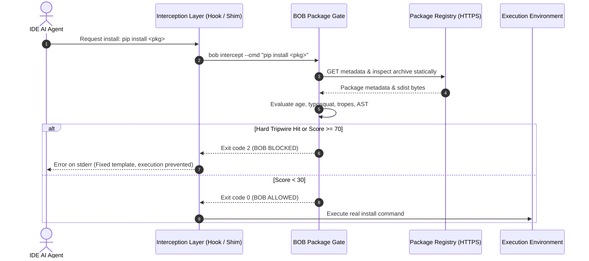
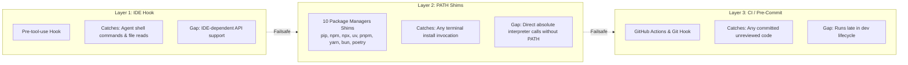

# BOB Architecture

This document describes the design, threat model, and components of BOB (`bouncer-on-board`).

---

## 1. Check before install

Scanning after installation is too late.

When an agent runs `pip install` or `npm install`:
- npm lifecycle scripts (`preinstall`, `install`, `postinstall`) run arbitrary shell code during unpacking. A malicious package can exfiltrate secrets before the command returns.
- Python sdist packages run `setup.py` and build backend hooks during wheel construction.
- Traditional audit tools (`pip-audit`, `npm audit`, OSV-scanner) only inspect lockfiles after installation finishes and untrusted code has already executed.

```
Traditional audit (too late):
[Agent Request] -> [Install runs, malicious code executes] -> [Audit scans lockfile]

BOB pre-install gate:
[Agent Request] -> [BOB intercepts, inspects statically] -> [Blocked: no code runs]
```

### Static inspection guarantee
BOB intercepts the installation request before the package manager executes. It fetches package metadata and archive bytes directly over HTTPS using `httpx` and parses them statically (`ast.parse` in Python, AST/JSON parsing in npm). BOB never runs `pip install`, `npm install`, `exec`, or `eval` on candidate packages.

---

## 2. Pre-execution gate (`bob intercept`)

The pre-execution gate runs synchronously on every pending tool command or file read. To avoid slowing down development loops, it runs deterministic checks only, targeting latency under 400ms (caching registry responses in `.bob/cache/`). No language model calls occur on this path.

### Interception sequence



### Risk signals
Packages evaluated by `pkg/gate.py` are scored across several signals:
1. Missing package on registry (hard block): Catches hallucinated package names.
2. OSV malicious advisories (hard block): Flagged in the OSV malicious database.
3. Package age: Packages under 14 days old score +35 to +50 points.
4. Typosquatting: Levenshtein distance <= 2 from top-downloaded packages scores +40 points.
5. Hallucination tropes: Popular names combined with `-utils`, `-helper`, `-ai`, or `-gpt` score +20 points.
6. Missing provenance: Missing homepage or repository link scores +15 points.
7. Install scripts: Decoded `exec`/`eval`, mass environment variable reads, or hardcoded URLs in setup scripts score +60 points.

Decision thresholds:
- Score >= 70: Block (exit code 2)
- Score 30 to 69: Warn (exit code 0, warning logged)
- Score < 30: Allow (exit code 0)

### Rule identifiers

| Rule ID | Category | Default Action | Description |
|:---|:---|:---|:---|
| `PKG-NOT-FOUND` | package | Block (Exit 2) | Package does not exist on PyPI/npm (likely hallucinated) |
| `PKG-MALICIOUS-ADVISORY` | package | Block (Exit 2) | Listed in OSV malicious package reports |
| `PKG-TOO-NEW` | package | Warn (Exit 0) | Package published under 14 days ago |
| `PKG-TYPOSQUAT` | package | Block (Exit 2) | Distance <= 2 to popular ecosystem packages |
| `PKG-LLM-TROPE` | package | Block (Exit 2) | Hallucinated trope suffix (e.g. `-utils`, `-helper`, `-ai`) |
| `PKG-NO-PROVENANCE` | package | Warn (Exit 0) | Missing repository or homepage metadata |
| `PKG-INSTALL-SCRIPT` | package | Block (Exit 2) | Suspicious script execution or credential reads in setup |
| `GUARD-SENSITIVE-PATH` | guard | Block (Exit 2) | Direct agent read/write of `.env`, `.ssh/`, `*.pem` |
| `GUARD-ENV-DUMP` | guard | Block (Exit 2) | Bulk environment variable secret dump (`printenv`, `export -p`, piped `env`) |
| `GUARD-REMOTE-EXEC` | guard | Block (Exit 2) | Remote script fetching piped directly into shell (`curl ... \| bash`, `irm ... \| iex`) |
| `GUARD-BOB-SELF-PROTECT` | guard | Block (Exit 2) | Agent attempts to modify `.bob/` or call `bob allow` |
| `INJ-001` to `INJ-020` | injection | Block (Exit 2) | Instruction overrides or secret exfiltration phrases |

#### Terminal message format
To protect against secondary injection, messages sent back to the agent use fixed templates:

```text
BOB BLOCKED [BOB-0007] rule=PKG-NOT-FOUND package=fastapi-jwt-session
Reason: Package 'fastapi-jwt-session' does not exist on PYPI (likely AI hallucinated / slopsquatting vector).
Do: remove it, ask the user, or pick a verified package. Do not retry this install.
```

---

## 3. Pre-deploy security gate (`bob scan`)

The pre-deploy gate runs before code is committed or merged. It coordinates parallel scanners, normalizes output into SARIF, and feeds findings to the AI provider for triage and patch generation.

### Scan workflow

```mermaid
flowchart TD
  subgraph Inputs ["Input Target"]
    Repo["Repository Workspace / Commits"]
  end

  subgraph Scanners ["Parallel Scanners (concurrent.futures)"]
    GL["Gitleaks (Secrets)"]
    SG["Semgrep (AST Patterns)"]
    OSV["OSV API (CVEs/Malware)"]
    BI["BOB Built-in (Fallback)"]
  end

  subgraph Processing ["Normalization & Deduplication"]
    SARIF["SARIF Normalizer"]
    Dedupe["Fingerprint Deduplicator"]
  end

  subgraph AI ["AI Triage (IDE Native or Ollama)"]
    Probe{"AI Available?"}
    Gemma["AI Triage<br/>(Explain, Triage Low/Med, Propose Diffs)"]
    Fallback["Static Rule Templates<br/>(Deterministic Fallback)"]
  end

  subgraph Output ["Reports & Gate Verdict"]
    Rep["Generate report.md & report.json"]
    GateCheck{"Critical / High Findings?"}
    Pass["Exit 0: Gate Passed"]
    Fail["Exit 1: Gate Blocked"]
  end

  Repo --> Scanners
  GL --> SARIF
  SG --> SARIF
  OSV --> Dedupe
  BI --> Dedupe
  SARIF --> Dedupe
  Dedupe --> Probe
  Probe -- Yes --> Gemma
  Probe -- No (or --no-ai) --> Fallback
  Gemma --> Rep
  Fallback --> Rep
  Rep --> GateCheck
  GateCheck -- No --> Pass
  GateCheck -- Yes --> Fail
```

### Triage and verification
- Privacy: When using `ide_native` or local Ollama, code stays local. No source files leave your machine.
- Safe prompting: Code snippets sent to models are wrapped in `<untrusted>...</untrusted>` tags to prevent indirect prompt injection. Secrets are masked before prompting.
- Manual review: Suggested patches are never applied automatically. Developers review diffs and verify fixes with `bob verify <fingerprint-prefix>`.

---

## 4. Defense-in-depth model

BOB uses three complementary interception layers:



| Layer | Mechanism | Coverage | Gap | Mitigation |
|:---|:---|:---|:---|:---|
| Layer 1: IDE Hook | IDE pre-tool-use extension | Shell commands, tool invocations, and file reads | Requires IDE hook support | Falls back to Layer 2 PATH shims |
| Layer 2: PATH Shims | Wrapper scripts in `~/.bob/shims` placed first on PATH | 10 CLI tools (`pip`, `pip3`, `npm`, `npx`, `uv`, `pnpm`, `yarn`, `bun`, `bunx`, `poetry`) | Non-PATH absolute binary calls | Layer 1 catches command strings; Layer 3 catches on commit |
| Layer 3: CI Gate | GitHub Action or pre-commit hook | Entire repository prior to merge | Runs late | Enforces repository-level merge block |

---

## 5. Security rules and invariants

1. Deterministic tools detect; AI triages and explains. The model never detects vulnerabilities from scratch and cannot hallucinate a pass.
2. The AI can be adversarial. The AI model can never suppress or lower Critical or High findings, and cannot approve packages. Any down-ranking of Medium or Low findings is logged for human review.
3. Messages to agents use fixed templates. BOB never echoes raw untrusted input or freeform model output back to the terminal, preventing secondary prompt injection.
4. BOB protects itself. Agent actions attempting to write to `.bob/` or run `bob allow` are blocked with rule `GUARD-BOB-SELF-PROTECT`. Allowlisting is strictly a human decision.
5. Honest reporting. If zero tripwires fire, BOB outputs:
   > *"0 known deterministic tripwires hit. This does not guarantee the absence of business-logic vulnerabilities."*

---

## 6. Command parsing & recursive unwrapping

Adversarial prompts and evasion scripts often wrap malicious installations inside subshells, elevated privileges, or environment prefixes:
- `bash -c "pip install evil-pkg"`
- `sudo npm install evil-pkg`
- `powershell -Command "poetry add evil-pkg"`
- `env DEBUG=1 /usr/local/bin/pip3 install evil-pkg`

To defeat evasion:
1. **Recursive Unwrapping** (`src/bob/cmdparse.py`): Recursively strips wrapping shells (`bash`, `sh`, `zsh`, `cmd`, `powershell`, `pwsh`), privilege elevators (`sudo`), and environment variables (`env VAR=val`).
2. **Path Normalization**: Uses `PurePath.name` to resolve executable basenames so `/usr/bin/pip` and `C:\Python310\Scripts\pip.exe` normalize to `pip`.
3. **Piped Stream Detection**: Intercepts and parses piped remote executions (`curl ... | bash`, `wget ... | sh`, `irm ... | iex`) to prevent in-memory remote code execution.
