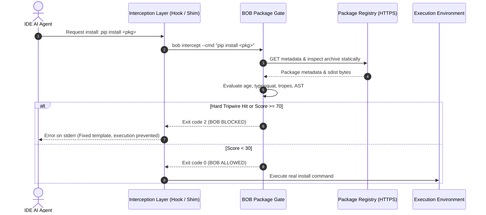

# BOB Architecture & Visual Technical Specification

This document details the architectural principles, threat models, and component workflows of **BOB (`bouncer-on-board`)**, an open-source, local-first security tool for the vibe-coding era.

---

## 1. The Core Invariant: Check BEFORE Install

The foundational rule of BOB is: **Scanning after installation is too late.**

When an AI coding agent runs `pip install` or `npm install`:
- **npm lifecycle scripts** (`preinstall`, `install`, `postinstall`) execute arbitrary shell code *during* the download and unpacking phase. A malicious package can exfiltrate `.env` secrets or SSH keys before the command even returns.
- **Python sdist packages** run `setup.py` / build backend hooks during wheel construction at install time.
- Traditional audit tools (`pip-audit`, `npm audit`, OSV-scanner) only inspect lockfiles or installed packages **after** installation has already completed and untrusted code has run.

```
Traditional Audit (Too Late):
[Agent Request] ──► [Install Runs + Malicious Code Executes ⚠️] ──► [Audit Scans Lockfile ❌]

BOB Pre-Install Invariant:
[Agent Request] ──► [BOB Intercept & Static Heuristics 🛡️] ──► [BLOCKED / No Code Runs ✅]
```

### Static Inspection Guarantee
BOB intercepts the installation request **before** the package manager executes. It fetches package metadata and archive bytes directly over HTTPS using `httpx` and parses them statically (`ast.parse` in Python; AST/JSON parsing in npm). **BOB never invokes `pip install`, `npm install`, `exec`, or `eval` on candidate packages.**

---

## 2. Path 1: `bob intercept` (Live Pre-Execution Gate)

Path 1 executes synchronously on every pending tool-use command or file read. To avoid slowing down developer vibe-coding loops, Path 1 runs **strictly deterministic checks** with a target latency of **< 400 ms** (caching registry responses in `.bob/cache/`). **No LLM calls occur on this path.**

### Interception Sequence Diagram



### Static Gate Heuristic Signals
Each package evaluated by `pkg/gate.py` collects weighted risk signals:
1. **Registry 404 (Hard Block):** Package does not exist on PyPI/npm (catches agent hallucinations).
2. **OSV Malicious Advisories (Hard Block):** Package flagged in OSV `MAL-*` database.
3. **Age Heuristic:** Packages < 14 days old score +35 to +50 points.
4. **Typosquatting:** Levenshtein distance $\le 2$ to top-N downloaded packages scores +40 points.
5. **LLM Tropes:** Popular package names with suffixes/prefixes like `-utils`, `-helper`, `-ai`, `-gpt` score +20 points.
6. **Provenance Check:** Missing homepage or source repository link scores +15 points.
7. **Install Script Static AST Inspection:** Base64 decode feeding `exec`/`eval`, mass `os.environ` reads, or exfiltration URLs score +60 points.

**Decision Thresholds:** Score $\ge 70 \rightarrow$ Block (exit 2); $30\text{--}69 \rightarrow$ Warn (exit 0, log warning); $< 30 \rightarrow$ Allow (exit 0).

### Stable Rule IDs & Output Message Formats
All deterministic findings emit standardized rule identifiers that upstream testing harnesses and IDE extensions assert on:

| Rule ID | Category | Default Action | Description |
|:---|:---|:---|:---|
| `PKG-NOT-FOUND` | package | Block (Exit 2) | Package does not exist on PyPI/npm (hallucination) |
| `PKG-MALICIOUS-ADVISORY` | package | Block (Exit 2) | Listed in OSV `MAL-*` malicious package reports |
| `PKG-TOO-NEW` | package | Warn (Exit 0) | Package published < 14 days ago |
| `PKG-TYPOSQUAT` | package | Block (Exit 2) | Levenshtein distance $\le 2$ to top-N ecosystem packages |
| `PKG-LLM-TROPE` | package | Block (Exit 2) | Hallucinated trope suffix (e.g. `-utils`, `-helper`, `-ai`) |
| `PKG-NO-PROVENANCE` | package | Warn (Exit 0) | Missing repository / homepage metadata |
| `PKG-INSTALL-SCRIPT` | package | Block (Exit 2) | Decoded `exec`/`eval`, exfiltration, or secret reads in setup |
| `GUARD-SENSITIVE-PATH` | guard | Block (Exit 2) | Direct agent read/write of `.env`, `.ssh/`, `*.pem`, etc. |
| `GUARD-BOB-SELF-PROTECT` | guard | Block (Exit 2) | Agent attempts to modify `.bob/` or call `bob allow` |
| `INJ-001` … `INJ-020` | injection | Block (Exit 2) | Instruction overrides, zero-width tags, or secret exfiltration phrases |

#### Standardized Terminal Message Format
To protect against secondary injection, terminal outputs to IDE agents follow strict, immutable templates:
```text
BOB BLOCKED [BOB-0007] rule=PKG-NOT-FOUND package=fastapi-jwt-session
Reason: package does not exist on PyPI (likely hallucinated).
Do: remove it, ask the user, or pick a verified package. Do not retry this install.
```

---

## 3. Path 2: `bob scan` (Pre-Deploy Security Gate)

Path 2 runs before code is committed or deployed. It orchestrates parallel deterministic scanners, normalizes outputs into SARIF, and feeds flagged findings into **local Gemma 4 (via Ollama)** for plain-English triage, false-positive down-ranking, and patch generation.

### Pre-Deploy Gate Flowchart

```mermaid
flowchart TD
  subgraph Inputs ["Input Target"]
    Repo["Repository Workspace / Commits"]
  end

  subgraph Scanners ["Parallel Scanners (concurrent.futures)"]
    GL["Gitleaks (Secrets)"]
    SG["Semgrep (AST Patterns)"]
    OSV["OSV API (CVEs/Malware)"]
    BI["BOB Built-in (Fallback)"]
  end

  subgraph Processing ["Normalization & Deduplication"]
    SARIF["SARIF Normalizer"]
    Dedupe["Fingerprint Deduplicator"]
  end

  subgraph AI ["Local SLM Triage (Ollama)"]
    Probe{"Ollama Available?"}
    Gemma["Gemma 4 E2B (~5.1B params)<br/>(Explain, Triage Low/Med, Propose Diffs)"]
    Fallback["Static Rule Templates<br/>(Deterministic Fallback)"]
  end

  subgraph Output ["Reports & Gate Verdict"]
    Rep["Generate report.md & report.json"]
    GateCheck{"Critical / High Findings?"}
    Pass["Exit 0: Gate Passed"]
    Fail["Exit 1: Gate Blocked"]
  end

  Repo --> Scanners
  GL --> SARIF
  SG --> SARIF
  OSV --> Dedupe
  BI --> Dedupe
  SARIF --> Dedupe
  Dedupe --> Probe
  Probe -- Yes --> Gemma
  Probe -- No (or --no-ai) --> Fallback
  Gemma --> Rep
  Fallback --> Rep
  Rep --> GateCheck
  GateCheck -- No --> Pass
  GateCheck -- Yes --> Fail
```

### Local SLM Triage & Verification Loop
- **Privacy & Local-First:** All model inferences run against `http://localhost:11434`. No source code or secrets leave the local machine.
- **Strict Evidence Wrapping:** Untrusted code snippets sent to Gemma are wrapped in `<untrusted>...</untrusted>` tags to mitigate indirect prompt injection. Secrets are masked (`first 4 chars + ****`) before prompting.
- **Verification Command:** Suggested patches are never auto-applied. Developers review patches manually and prove resolution using `bob verify <fingerprint-prefix>`.

---

## 4. The 3-Tier Defense-in-Depth Model

To prevent single-point bypasses, BOB establishes three complementary interception layers:

```mermaid
flowchart LR
  subgraph L1 ["Layer 1: IDE Hook"]
    direction TB
    H1["Pre-tool-use Hook"]
    C1["Catches: Agent shell commands & file reads"]
    G1["Gap: IDE-dependent API support"]
  end

  subgraph L2 ["Layer 2: PATH Shims"]
    direction TB
    H2["pip / npm / uv Wrappers"]
    C2["Catches: Any CLI install invocation"]
    G2["Gap: python -m pip indirect calls"]
  end

  subgraph L3 ["Layer 3: CI / Pre-Commit"]
    direction TB
    H3["GitHub Actions & Git Hook"]
    C3["Catches: Any committed unreviewed code"]
    G3["Gap: Runs late in dev lifecycle"]
  end

  L1 -.->|Failsafe| L2
  L2 -.->|Failsafe| L3
```



| Layer | Mechanism | Coverage | Known Bypass / Gap | Mitigation |
|:---|:---|:---|:---|:---|
| **L1: IDE Hook** | IDE pre-tool-use extension | Agent shell executions, tool invocations, and file reads | Not all IDEs expose pre-tool execution hooks | Fall back to L2 PATH shims + advisory skill |
| **L2: PATH Shims** | `bob shim install` creates wrapper scripts earlier on PATH | Terminal installs (`pip`, `npm`, `uv`) | `python -m pip` bypasses binary shims | L1 intercepts `-m pip`; L3 catches on commit |
| **L3: CI Gate** | GitHub Action / Pre-commit hook | Entire repository state prior to merge | Runs late by design | Enforces repository-level merge block |

---

## 5. Security Axioms & Self-Protection

1. **Deterministic tools detect; AI triages and explains.** The model never detects vulnerabilities from scratch and cannot hallucinate a pass.
2. **The LLM can be attacked.** The SLM can **never** suppress or lower `critical` or `high` findings, and cannot approve packages. Every down-rank of medium/low findings is explicitly logged for human review.
3. **Messages to IDE agents use fixed templates.** BOB never echoes raw untrusted input or freeform LLM output back to the agent CLI, preventing secondary prompt injection.
4. **BOB protects itself.** Agent actions attempting to write to `.bob/` or execute `bob allow` are blocked with rule `GUARD-BOB-SELF-PROTECT`. Allowlisting is human-only.
5. **Honest Posture:** If zero tripwires fire, BOB outputs the exact sentence:
   > *"0 known deterministic tripwires hit. This does not guarantee the absence of business-logic vulnerabilities."*
